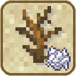
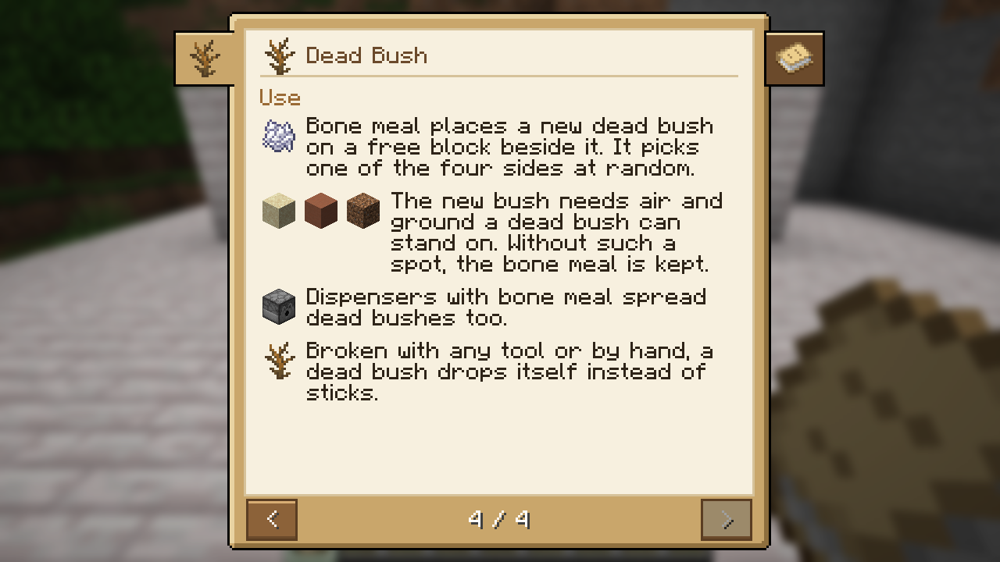

# Dead Bush Bonemeal

A small farming tweak for Minecraft 26.3 (Fabric). **Bone meal spreads dead bushes** exactly the way it spreads
firefly bushes: a new dead bush appears on a free block beside the one you use it on. **Spore blossoms** spread the
same way along the ceiling. Dead bushes, spore blossoms and, unlike vanilla, firefly bushes also follow ground or a
ceiling that steps one block up or down. And **dead bushes drop themselves**, broken by hand or with any tool, so you no longer need
shears to collect them. The mod adds no items and no blocks besides its guide book; it changes the vanilla dead bush,
spore blossom and firefly bush. The guide book is in its own creative tab,
*Dead Bush Bonemeal*.

## Download

Get `deadbushbonemeal-<version>.jar` from [CurseForge](https://www.curseforge.com/minecraft/mc-mods/dead-bush-bonemeal) or the
[GitHub releases](../../releases) and put it into `mods/` on the client and the server, next to Fabric API. Requires Minecraft 26.3, Fabric Loader 0.19.5+ and Java 25.

## The guide book

The **Dead Bush Bonemeal Guide** is a short book about the dead bush and the spore blossom, in English and German. Craft it from a book and
a dead bush, or take it from the creative tab. Right-click opens it, E or Escape closes it; the dead bush's tab is on
the left, Getting Started on the right.

This page follows the book chapter by chapter and adds the details that do not fit on its pages.

<!-- listing:skip -->
| Chapter | |
|---|---|
| [Getting Started](#getting-started) | find, plant and spread your first dead bush |
| [Dead Bush](#dead-bush) | where it grows, how bone meal spreads it, what it drops |
| [Spore Blossom](#spore-blossom) | where it hangs, how bone meal spreads it |

Not in the book: [Building](#building).
<!-- listing:end -->

## Getting Started

Dead bushes and spore blossoms grow with bone meal now, the same way firefly bushes do, and dead bushes always drop
themselves.

1. Find a dead bush in a desert or badlands and break it. It drops itself.
2. Plant it on sand, terracotta or dirt.
3. Right-click it with bone meal: a second bush grows next to it.

Firefly bushes now also spread onto ground one block higher or lower.

## Dead Bush

The vanilla dead bush, now a plant you can farm. It grows in deserts, badlands and wooded badlands, on sand and
terracotta.

> *"Low maintenance. Very low."*

**Use**

- Right-click a dead bush with bone meal: a new dead bush appears on a free spot beside it, picked at random.
  Besides the four blocks next to it, the spots one block higher or lower count too, so the bushes follow uneven
  ground. Firefly bushes get the same rule. Bone meal particles and the sound are the vanilla ones.
- The new bush needs air and ground a dead bush can stand on (sand, red sand, terracotta, dirt and the other
  vegetation soils, the block tag `#minecraft:supports_dry_vegetation`). Without such a spot, nothing happens and the
  bone meal is kept.
- Everything vanilla bone meal can do works here too: bone meal in the offhand, holding the button down while
  sweeping over several bushes, and dispensers loaded with bone meal.
- Break a dead bush by hand or with any tool: it drops itself instead of sticks. Explosions still destroy it without
  a drop.

Short and tall dry grass keep their own vanilla bone meal behaviour.

## Spore Blossom

The vanilla spore blossom, now a plant you can multiply. It hangs from the ceilings of lush caves and drops itself
when broken, as in vanilla.

> *"Grows on you. Well, above you."*

**Use**

- Right-click a spore blossom with bone meal: a new spore blossom appears on a free spot beside it, picked at random.
  As with the dead bush, the spots one block higher or lower count too: the blossom follows a ceiling that steps up
  or down.
- The new blossom needs air and a block above it whose bottom face is solid enough to hang from, the same rule as
  placing a spore blossom by hand (not in water). Without such a spot, nothing happens and the bone meal is kept.
- Bone meal from the offhand, held-down sweeping and dispensers loaded with bone meal work as for the dead bush.

<!-- listing:skip -->
## Building

Java 25, `./gradlew build` → `build/libs/deadbushbonemeal-<version>.jar`.

The guide book's content is `GuideBook.java` with the texts in `lang/en_us.json` and `lang/de_de.json`;
`./gradlew runClient -PbookShots` writes every page to `run/screenshots/` (needs a world `run/saves/bookshots` and
[bcf-guide-book-lib](https://github.com/david-stefan-hermann/bcf-guide-book-lib) in the local Maven repository:
`./gradlew publishToMavenLocal` in a checkout of it).

The bone meal behaviour is `Spreading` (the firefly bush's `BonemealableBlock` logic, plus spots one block up or
down) and three mixins that use it: `DryVegetationBlockMixin` (dead bush), `SporeBlossomBlockMixin` and
`FireflyBushBlockMixin`; the drop is the loot table `data/minecraft/loot_table/blocks/dead_bush.json`.
<!-- listing:end -->

## License

MIT, see [LICENSE](LICENSE). By BaconCakeFactory.
